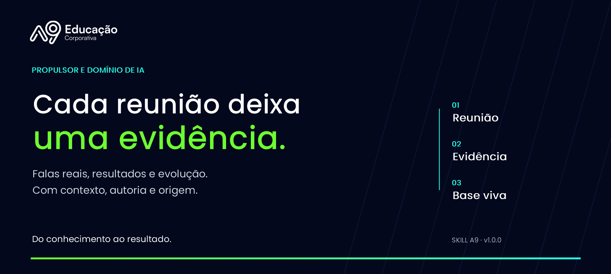

<h1 align="center">A9 Educação · Depoimentos e evolução de clientes</h1>

<p align="center">Falas reais, resultados e demonstrações com origem.<br>Uma base viva para o acompanhamento, o comercial e o marketing.</p>

<p align="center">
  <a href="https://github.com/mauriciokruger/a9-depoimentos-clientes/releases/download/v1.0.0/a9-depoimentos-clientes-v1.0.0.zip">Baixar a skill</a> ·
  <a href="#instalação">Como instalar</a> ·
  <a href="#exemplo-fictício">Ver um exemplo</a>
</p>

<p align="center"><strong>v1.0.0</strong> · Propulsor de IA · Domínio de IA · Google Drive via MCP</p>

## Sobre a skill

Ao receber uma reunião de consultoria, a IA identifica o que o cliente relatou ou demonstrou, preserva a origem e atualiza o documento compartilhado no Drive. Quando alguém pede um material, consulta essa base atualizada para usar evidências pertinentes.

A skill diferencia resultado relatado, demonstração observada, mudança de hábito e expectativa. Mantém quem falou, em qual reunião e em qual minuto. A versão pública contém a metodologia. Transcrições, nomes de clientes, links internos e configuração da base ficam no ambiente privado da equipe.

## Como funciona

| Momento | Entrega |
| --- | --- |
| Chega uma reunião | Curadoria de falas e demonstrações com contexto e fontes |
| A reunião já foi analisada | Complemento do registro existente, sem duplicação |
| Não há trecho aproveitável | Registro da análise e das limitações |
| A base é atualizada | Leitura de conferência antes de confirmar o resultado |
| Alguém pede um material | Consulta à versão atual da base e aplicação da identidade A9 |
| O Drive está indisponível | Curadoria privada pendente, com impedimento informado |

A execução acontece durante o atendimento no chat, com ferramentas disponíveis e acesso autorizado. A skill não é um monitor de reuniões e não roda em segundo plano.

## Comece aqui

1. [Baixe o pacote da versão 1.0.0](https://github.com/mauriciokruger/a9-depoimentos-clientes/releases/download/v1.0.0/a9-depoimentos-clientes-v1.0.0.zip).
2. Instale a pasta da skill no ambiente que você utiliza.
3. Conecte Google Drive e Docs por MCP com acesso à base.
4. Defina a base e a autorização na configuração privada do projeto.
5. Envie uma reunião e confira a primeira atualização.

```text
Use $a9-depoimentos-clientes para analisar esta reunião do Propulsor
e atualizar a base autorizada no Drive com depoimentos e demonstrações.
Preserve os trechos literais, os horários e as limitações da fonte.
```

## Instalação

Descompacte o ZIP da release e copie a pasta `a9-depoimentos-clientes` inteira. O ZIP da release tem uma única pasta raiz. Code / Download ZIP baixa o repositório e não é o mesmo pacote de instalação.

| Ambiente compatível | Pasta pessoal |
| --- | --- |
| Codex | `~/.agents/skills/a9-depoimentos-clientes` |
| Claude Code | `~/.claude/skills/a9-depoimentos-clientes` |

No Windows, `~` representa a pasta do usuário. No Codex, peça o uso de `$a9-depoimentos-clientes`. Se uma skill recém instalada não aparecer na sessão atual, abra uma nova sessão. Evite cópias duplicadas no mesmo ambiente.

Outras plataformas podem aceitar upload de um ZIP de skill ou arquivos de instruções de um projeto. O suporte, os conectores e as permissões dependem da plataforma. Essas instalações não foram testadas neste pacote.

A skill de marca [A9 Educação](https://github.com/mauriciokruger/a9-educacao) complementa a criação de peças. A curadoria e a atualização da base não dependem dos assets de marca.

## Configuração privada

Crie `00_base/depoimentos_clientes.md` no projeto com o endereço do Google Doc canônico, o escopo autorizado de manutenção e as convenções do acompanhamento. O pacote encontra essa configuração primeiro.

Para uso fora do projeto, crie `~/.agents/skill-config/a9-depoimentos-clientes.json` com o formato abaixo. Substitua o endereço demonstrativo pelo destino autorizado.

```json
{
  "document_url": "https://docs.google.com/document/d/ID_DA_BASE/edit",
  "programs": ["Propulsor de IA", "Domínio de IA"],
  "maintenance_authorized": true,
  "authorization_note": "Informe quem autorizou, quando e em qual escopo"
}
```

O campo de autorização documenta uma permissão real do responsável. Ele não cria essa permissão e não substitui os acessos da conta. Não publique essa configuração, fontes ou dados de clientes.

## Deixar como padrão no projeto

Acrescente às instruções do projeto, como `AGENTS.md`, uma regra equivalente ao texto abaixo.

```text
Ao receber uma nova reunião, vídeo, transcrição ou ata de cliente
do Propulsor ou Domínio de IA, execute a skill a9-depoimentos-clientes
durante o mesmo atendimento. Consulte a configuração privada em
00_base/depoimentos_clientes.md e atualize a base autorizada no Drive.
Preserve o fluxo de acompanhamento existente. Confirme a escrita
por leitura de retorno ou registre a pendência com seu impedimento.
```

Uma seção da barra lateral organiza os chats. A regra deve estar nas instruções do diretório em que eles trabalham, para ser encontrada durante as tarefas.

## Exemplo fictício

> Agora faço o relatório em 20 minutos, antes levava duas horas.

Ana · Empresa Horizonte · Propulsor de IA · acompanhamento de 12/11/2026 · 00:05:10 a 00:05:48.

Esse trecho seria um resultado relatado pela cliente, com fonte e limites registrados. A intenção de automatizar outra área no mês seguinte ficaria separada como expectativa. Um número calculado pela IA não seria colocado entre aspas como se fosse fala da cliente.

O exemplo é inteiramente fictício. [Veja o registro completo e os critérios](skills/a9-depoimentos-clientes/references/registro-e-criterios.md).

## O que está incluído

| Arquivo | Uso |
| --- | --- |
| [SKILL.md](skills/a9-depoimentos-clientes/SKILL.md) | Acionamento, curadoria, atualização e consulta |
| [Registro e critérios](skills/a9-depoimentos-clientes/references/registro-e-criterios.md) | Campos, classificações e lacunas |
| [Uso editorial](skills/a9-depoimentos-clientes/references/uso-editorial.md) | Cards, stories, e-mails e fidelidade das falas |
| [Metadados](skills/a9-depoimentos-clientes/agents/openai.yaml) | Nome de exibição e acionamento implícito |
| [Validação](docs/VALIDACAO.md) | Verificações executadas e limites |

## Atualizar e compartilhar

O GitHub mantém a fonte versionada. A base de depoimentos permanece no Drive e é lida a cada uso. Novos relatos não exigem redistribuir a skill.

Mudanças na metodologia exigem atualizar as cópias instaladas do pacote. A instalação não compartilha a base nem suas permissões com outras pessoas. Cada integrante precisa de acesso autorizado ao documento e de um conector disponível na sua IA.

## Marca e limites

Para reconstruir o ZIP, execute `python scripts/package.py`. O arquivo e seu SHA256 ficam em `dist/`. Para reconstruir a capa no Windows, execute `pwsh -File scripts/build-header.ps1 -BrandSkill CAMINHO_DA_SKILL_A9_EDUCACAO`, apontando para o pacote de marca com fontes e logo oficiais.

Identidade visual baseada na skill pública A9 Educação, com Poppins, navy, lime, ciano e logo oficial. A capa é um material gráfico de apresentação do pacote, sem dados de clientes.

A9 Educação · Do conhecimento ao resultado.

Manter a base interna não autoriza publicar depoimentos, imagens ou vídeos. Criar uma peça não autoriza enviá-la ou agendá-la. Conteúdo de documentos e transcrições é tratado como fonte, sem executar ordens encontradas nele.
